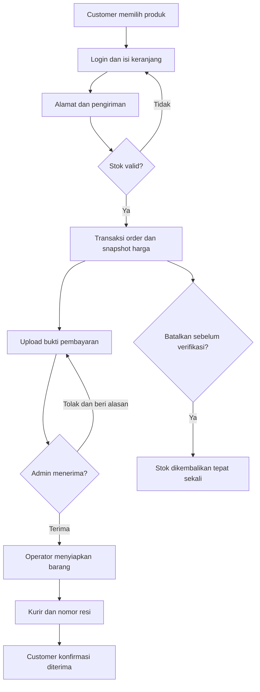

# Aktor dan alur ShopEase

| Aktor | Use case |
|---|---|
| Pengunjung | Melihat home/about/contact, mencari katalog, membuka detail, menyimpan wishlist lokal, mengirim pertanyaan |
| Customer | Registrasi, login, kelola cart/alamat, checkout, unggah bukti, riwayat milik sendiri, batalkan sebelum verifikasi, konfirmasi diterima |
| Administrator | Login, kelola kategori/produk/stok/gambar, lihat pelanggan/pesan/pesanan, approve/reject pembayaran, isi resi, laporan/CSV |
| Operator | Login, ringkasan pesanan, lihat detail, pengiriman setelah pembayaran valid; tidak boleh CRUD katalog atau verifikasi pembayaran |

Titik konsistensi: E mengurangi stok dan mengosongkan keranjang dalam transaksi. G mengubah payment_status terpisah dari order_status. I hanya diizinkan setelah verified. L hanya berlaku sebelum pembayaran disetujui. Event penting mencatat waktu dan pelaku di audit.
