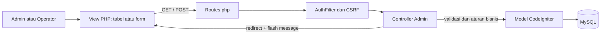
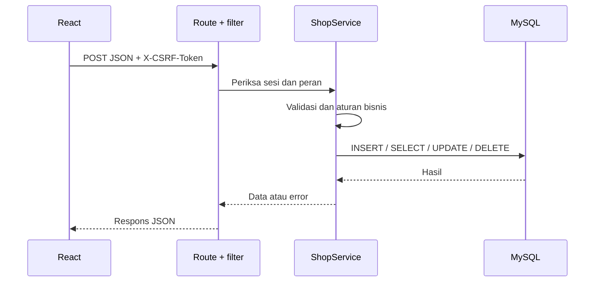
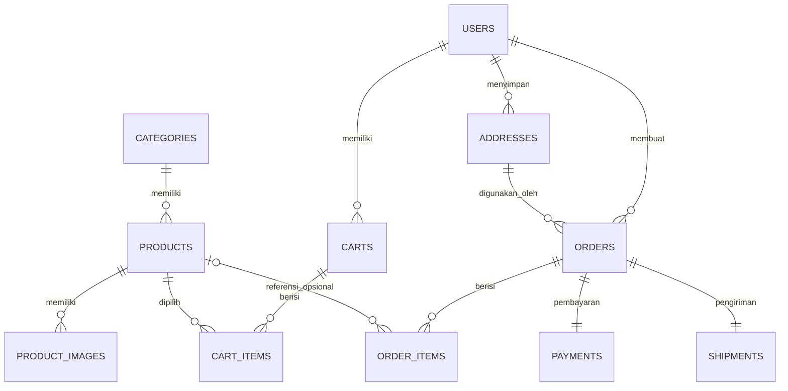
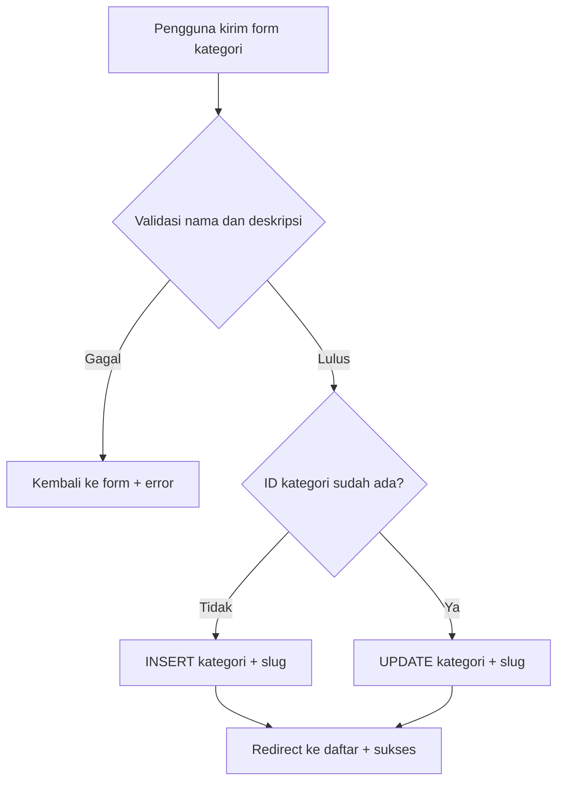
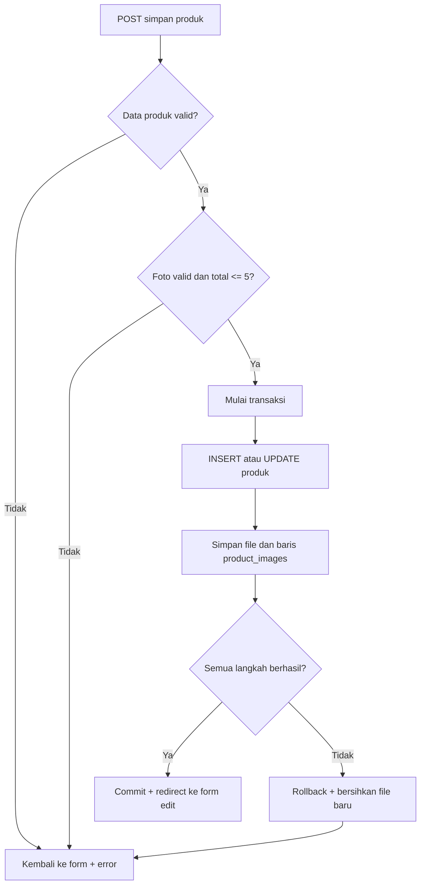
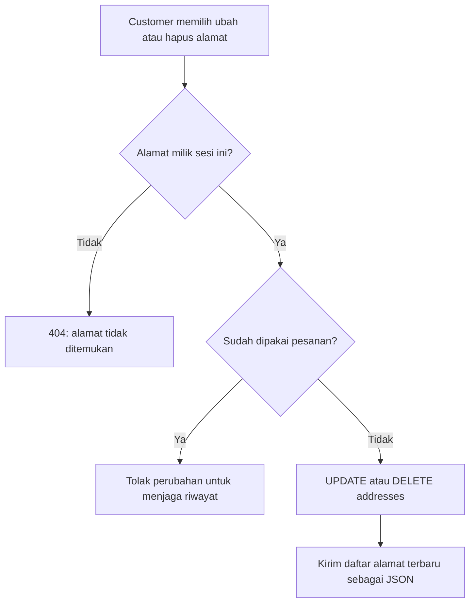

# Dokumentasi CRUD ShopEase

Dokumentasi ini menjelaskan implementasi **Create, Read, Update, Delete (CRUD)** pada source ShopEase saat ini. Fokusnya adalah kategori, produk dan galeri, data karyawan, serta alamat pengiriman. Inventori, keranjang, profil, dan pesanan dijelaskan karena ikut mengubah data yang dikelola CRUD.

> **Acuan:** kode aplikasi per 21 November 2026. Jika angka pada panduan lama berbeda, gunakan batas yang diterapkan controller dan model saat menjalankan aplikasi.

## Daftar isi

- [Ringkasan modul](#ringkasan-modul)
- [Teknologi dan struktur proyek](#teknologi-dan-struktur-proyek)
- [Arsitektur dan alur request](#arsitektur-dan-alur-request)
- [Hak akses dan keamanan](#hak-akses-dan-keamanan)
- [Relasi data](#relasi-data)
- [CRUD kategori](#crud-kategori)
- [CRUD produk](#crud-produk)
- [CRUD galeri produk](#crud-galeri-produk)
- [CRUD data karyawan](#crud-data-karyawan)
- [CRUD alamat pengiriman](#crud-alamat-pengiriman)
- [Operasi data lain](#operasi-data-lain)
- [Menjalankan dan memeriksa aplikasi](#menjalankan-dan-memeriksa-aplikasi)
- [Catatan implementasi](#catatan-implementasi)

## Ringkasan modul

| Modul | Create | Read | Update | Delete | Pengguna |
| --- | --- | --- | --- | --- | --- |
| Kategori | Ya | Ya | Ya | Ya, jika tidak dipakai produk | Admin, Operator melalui halaman MVC |
| Produk | Ya | Ya | Ya | Ya, jika tidak ada di keranjang dan database mengizinkan | Admin, Operator melalui halaman MVC |
| Galeri produk | Saat unggah produk | Pada form edit dan katalog | Ganti gambar utama | Hapus satu gambar | Admin, Operator |
| Data karyawan | Ya | Ya | Ya | Ya | Admin |
| Alamat pengiriman | Ya | Ya | Ya, jika belum dipakai pesanan | Ya, jika belum dipakai pesanan | Customer, hanya alamat sendiri |
| Inventori | — | Ya | Stok | — | Admin, Operator |
| Keranjang | Tambah item | Lihat item | Ubah jumlah | Jumlah `0` menghapus item | Customer |

## Teknologi dan struktur proyek

- **Backend:** PHP, CodeIgniter 4, MySQL/MariaDB.
- **Halaman pengelolaan:** view PHP dengan Bootstrap 5.
- **Antarmuka pelanggan:** React di `frontend/ShopEase.tsx`, berkomunikasi dengan API JSON.
- **Database:** skema dasar di `database/schema.sql`; perubahan berikutnya di `app/Database/Migrations/`.
- **Routing:** `app/Config/Routes.php`. Auto routing dinonaktifkan, sehingga hanya route yang didefinisikan yang dapat dipanggil.

```text
ShopEase/
├── app/
│   ├── Config/
│   │   ├── Routes.php                  # Endpoint dan filter peran
│   │   └── Filters.php                 # CSRF dan filter global
│   ├── Controllers/
│   │   ├── Admin/                     # CRUD MVC pengelolaan
│   │   ├── ApiController.php          # Respons dan error JSON
│   │   ├── CartController.php
│   │   └── CheckoutController.php
│   ├── Filters/AuthFilter.php         # Login dan otorisasi peran
│   ├── Models/                     # Tabel, kunci, allowedFields, validasi
│   ├── Services/ShopService.php    # Aturan bisnis API pelanggan dan API lama
│   └── Views/admin/               # Form dan daftar pengelolaan
├── database/schema.sql             # Tabel dan relasi dasar MySQL
├── frontend/ShopEase.tsx           # UI pelanggan dan pemanggil API
└── public/uploads/products/        # Foto produk hasil unggah MVC
```

## Arsitektur dan alur request

### Halaman pengelolaan MVC



`GET` membaca daftar atau membuka form. Form `POST` mengirim data dan token CSRF. Controller memvalidasi input, memanggil model, lalu mengarahkan kembali ke daftar atau form dengan pesan sukses/kesalahan. View memakai `esc()` ketika menampilkan data pengguna.

### API pelanggan



React mengambil token dari `GET /api/session`. Helper `api()` di `frontend/ShopEase.tsx` memasukkannya ke header `X-CSRF-Token` untuk request API.

## Hak akses dan keamanan

| Area | Peran yang diizinkan |
| --- | --- |
| `/admin/products`, `/admin/categories`, `/admin/inventory` | Admin dan Operator |
| `/admin/karyawan` | Admin |
| `/api/addresses`, `/api/cart`, `/api/profile`, `/api/checkout` | Customer |
| `/api/admin/product`, `/api/admin/category` (API lama) | Admin |

`AuthFilter` menolak request tanpa sesi dan request dengan peran yang tidak sesuai. CSRF diaktifkan secara global dalam `app/Config/Filters.php`. Setiap form pengelolaan memakai `csrf_field()`. Pemeriksaan pada browser membantu pengguna, tetapi controller atau service tetap memvalidasi ulang di server. Model membatasi kolom yang dapat diisi melalui `allowedFields`.

## Relasi data



Tabel `karyawan` berdiri sendiri sebagai data staf. Membuat data karyawan **tidak** otomatis membuat akun pada tabel `users`. `product_images.id_product` mengacu ke `products.id` dan ikut terhapus melalui foreign key `ON DELETE CASCADE`. Pada skema MySQL terbaru, `order_items.product_id` boleh `NULL` saat produk dihapus; nama, harga, dan kuantitas produk tetap tersimpan di item pesanan.

## CRUD kategori

**File:** `app/Controllers/Admin/CategoryController.php`, `app/Models/CategoryModel.php`, `app/Views/admin/categories/`.

| Operasi | Method dan route | Proses |
| --- | --- | --- |
| Create | `GET /admin/categories/create` → `POST /admin/categories/store` | Buka form, validasi, buat ID acak dan slug, lalu `insert()` |
| Read | `GET /admin/categories` | Ambil seluruh kategori, urut berdasarkan nama |
| Update | `GET /admin/categories/edit/{id}` → `POST /admin/categories/update/{id}` | Pastikan ID ada, validasi, lalu `update()` |
| Delete | `POST /admin/categories/delete/{id}` | Pastikan ID ada dan tidak memiliki produk, lalu `delete()` |

**Validasi:** nama wajib 3–100 karakter; deskripsi opsional maksimal 10.000 karakter. Slug dibentuk dari nama dan ID agar unik. Jika kategori masih dipakai produk, controller menolak penghapusan dan menampilkan pesan. Relasi foreign key pada database juga melindungi konsistensi data.



## CRUD produk

**File:** `app/Controllers/Admin/ProductController.php`, `app/Models/ProductModel.php`, `app/Views/admin/products/`.

| Operasi | Method dan route | Proses |
| --- | --- | --- |
| Create | `GET /admin/products/create` → `POST /admin/products/store` | Validasi produk dan foto, buat ID serta slug, simpan dalam transaksi |
| Read | `GET /admin/products` | Daftar, statistik, pencarian, filter, paginasi |
| Update | `GET /admin/products/edit/{id}` → `POST /admin/products/update/{id}` | Pastikan produk ada, validasi, perbarui produk dan foto dalam transaksi |
| Delete | `POST /admin/products/delete/{id}` | Tolak jika masih di keranjang; jika database mengizinkan, hapus produk dan file foto unggahan |

**Validasi server:** nama 3–150 karakter; kategori wajib ada; harga dan stok berupa bilangan bulat 0–1.000.000.000; status harus `tersedia` atau `tidak_tersedia`; deskripsi maksimal 10.000 karakter. Nilai status formulir dipetakan menjadi `active` atau `inactive` di database. **Stok nol selalu menghasilkan status `inactive`.**

**Read:** pencarian menurut nama, filter kategori, stok rendah 1–5, stok habis 0, urutan produk terbaru, dan **8 baris per halaman**. Halaman juga menghitung total produk, kategori, produk aktif, dan tidak aktif.

**Konsistensi:** penyimpanan memakai transaksi database. Saat mengedit produk di MySQL, baris produk dikunci dengan `SELECT ... FOR UPDATE`. Jika penyimpanan gagal, transaksi dibatalkan dan file baru yang sudah dipindahkan dihapus. Ketika menghapus produk, controller lebih dulu memeriksa `cart_items`. Foreign key dapat menolak penghapusan apabila masih ada referensi lain yang tidak mengizinkannya.



## CRUD galeri produk

**File:** `app/Controllers/Admin/ProductController.php`, `app/Models/ProductImageModel.php`, `app/Views/admin/products/form.php`.

- Saat create atau update produk, form dapat mengunggah banyak foto sekaligus. Batasnya **5 foto per produk**, masing-masing maksimal **2 MB**.
- Format yang diterima: JPG, PNG, WEBP. Server memeriksa validitas unggahan, MIME, ekstensi, dan isi gambar dengan `getimagesize()`.
- File disimpan di `public/uploads/products/` dengan nama acak. Baris metadata masuk ke `product_images`.
- Foto pertama menjadi gambar utama jika produk belum mempunyai foto galeri. URL foto utama juga disimpan di `products.image` untuk katalog.
- `POST /admin/products/{id}/images/{imageId}/primary` menjadikan foto sebagai gambar utama.
- `POST /admin/products/{id}/images/{imageId}/delete` menghapus satu foto. Jika itu foto utama, sistem memilih foto berikutnya. Jika tidak ada foto, produk memakai `/images/placeholder.svg`.
- Aksi foto memeriksa bahwa `imageId` benar-benar milik produk pada URL, memakai transaksi, lalu menghapus file setelah perubahan database berhasil.

## CRUD data karyawan

**File:** `app/Controllers/Admin/KaryawanController.php`, `app/Models/KaryawanModel.php`, `app/Views/admin/karyawan/`.

| Operasi | Method dan route | Proses |
| --- | --- | --- |
| Create | `GET /admin/karyawan/create` → `POST /admin/karyawan/store` | Validasi model, lalu `insert()` |
| Read | `GET /admin/karyawan` | Pencarian nama/NIP, filter jabatan, paginasi 8 baris |
| Update | `GET /admin/karyawan/edit/{id}` → `POST /admin/karyawan/update/{id}` | Pastikan ID ada, lalu `save()` |
| Delete | `POST /admin/karyawan/delete/{id}` | Pastikan ID ada, lalu `delete()` |

**Validasi model:** NIP numerik 8–20 digit dan unik; nama 3–100 karakter; jabatan salah satu dari Admin Toko, Staf Gudang, Customer Service, Kurir, Kasir; email valid dan unik; telepon numerik 10–15 digit; tanggal masuk berformat `Y-m-d`; status `aktif` atau `nonaktif`. Database juga mempunyai kunci unik untuk NIP dan email. Model mengisi `created_at` dan `updated_at` melalui timestamps.

## CRUD alamat pengiriman

**File:** `app/Controllers/CheckoutController.php`, `app/Services/ShopService.php`, `frontend/ShopEase.tsx`.

| Operasi | Method dan endpoint | Hasil |
| --- | --- | --- |
| Create | `POST /api/addresses` | Menyimpan alamat untuk customer yang sedang login |
| Read | `GET /api/addresses` | Mengembalikan alamat milik customer tersebut |
| Update | `POST /api/addresses/{id}/update` | Mengubah alamat miliknya yang belum dipakai pesanan |
| Delete | `POST /api/addresses/{id}/delete` | Menghapus alamat miliknya yang belum dipakai pesanan |

Data meliputi nama penerima, telepon, alamat lengkap, kota, provinsi, dan kode pos. Server memeriksa panjang tiap kolom, format telepon, dan kode pos **tepat lima angka**. Query update/delete memakai `id` **dan** `user_id` dari sesi, sehingga customer lain tidak dapat mengubah alamat tersebut. Alamat yang sudah direferensikan oleh `orders.address_id` ditolak untuk update dan delete agar riwayat pengiriman tidak berubah. UI tambah, edit, dan hapus berada dalam modal **Alamat Pengiriman**.



## Operasi data lain

### Inventori

`GET /admin/inventory` menampilkan tab stok rendah, stok habis, atau semua produk. `POST /admin/inventory/update/{id}` menerima stok bilangan bulat 0–1.000.000.000. Stok nol membuat produk tidak aktif. Ketika stok dinaikkan kembali, status produk yang sebelumnya dinonaktifkan manual tetap dipertahankan. Ini adalah operasi **Read dan Update**, bukan CRUD lengkap.

### Keranjang

Customer memakai `GET /api/cart` dan `POST /api/cart`. Request POST berisi `product_id` dan `quantity`. Jumlah positif menambah atau mengubah item setelah pemeriksaan status produk dan ketersediaan stok. Jumlah `0` menghapus item. Data `cart_items` dibatasi pada keranjang milik pengguna dalam sesi.

### Profil dan pesanan

`POST /api/profile` mengubah data profil atau password customer. Checkout `POST /api/checkout` membuat `orders`, `order_items`, `payments`, dan `shipments` dalam satu transaksi, sekaligus mengurangi stok dan mengosongkan keranjang. `GET /api/orders` dan `GET /api/orders/{id}` membaca pesanan. `POST /api/order-action` hanya mengizinkan perpindahan status tertentu sesuai peran dan status saat ini; pesanan bukan CRUD bebas.

### API admin lama

`POST /api/admin/category` dan `POST /api/admin/product` masih tersedia **khusus Admin** melalui `ShopService`. Aturannya tidak seluruhnya sama dengan halaman MVC. Khususnya, aksi `delete` produk pada API lama **mengubah status menjadi `inactive`**, sedangkan tombol hapus di halaman MVC mencoba menghapus baris produk secara fisik. Untuk menjelaskan perilaku tombol pada panel pengelolaan, ikuti controller MVC.

## Menjalankan dan memeriksa aplikasi

Ikuti konfigurasi database di [panduan versi terbaru](PANDUAN_VERSI_TERBARU.md), kemudian jalankan dari folder proyek:

```bat
C:\xampp_new\php\php.exe spark migrate
C:\xampp_new\php\php.exe spark db:seed ShopSeeder
C:\xampp_new\php\php.exe spark serve
```

Buka `http://localhost:8080`. Sesuaikan path PHP dan port database di `.env` dengan instalasi lokal. Untuk melihat hasil CRUD, masuk menggunakan akun yang perannya sesuai lalu buka menu **Produk**, **Kategori**, **Inventori**, atau **Data Karyawan**. Customer mengelola alamat melalui menu **Alamat Pengiriman**.

Pemeriksaan manual yang relevan:

1. Tambah kategori, ubah namanya, lalu coba hapus setelah dipakai produk; penghapusan harus ditolak.
2. Tambah produk dengan foto, ubah stok/status, ganti foto utama, dan hapus satu foto.
3. Cari produk dan periksa filter stok rendah/habis serta paginasi.
4. Masukkan produk ke keranjang customer, lalu coba hapus dari panel; penghapusan harus ditolak.
5. Tambah dan ubah alamat customer. Setelah alamat dipakai checkout, perubahan dan penghapusan harus ditolak.
6. Masuk sebagai Operator dan pastikan menu produk/kategori tersedia, sedangkan CRUD karyawan tidak tersedia.

## Catatan implementasi

- Kode saat ini menggunakan **maksimal 5 foto produk** dan **8 produk per halaman**. Angka 8 foto/10 baris dalam `PANDUAN_VERSI_TERBARU.md` adalah informasi dari versi sebelumnya.
- CRUD karyawan mengelola **data staf**, sedangkan akun login berada pada tabel `users` dan mengikuti alur autentikasi terpisah.
- Penolakan penghapusan produk yang berada di keranjang dilakukan di controller. Referensi database lain masih dapat membuat penghapusan gagal; controller menampilkan pesan gagal jika itu terjadi.
- Menghapus produk dari database tidak menghapus salinan nama, harga, dan jumlah yang telah tersimpan dalam item pesanan.

## Referensi source

- Routing dan akses: [`app/Config/Routes.php`](../app/Config/Routes.php), [`app/Filters/AuthFilter.php`](../app/Filters/AuthFilter.php), [`app/Config/Filters.php`](../app/Config/Filters.php).
- CRUD MVC: [`CategoryController.php`](../app/Controllers/Admin/CategoryController.php), [`ProductController.php`](../app/Controllers/Admin/ProductController.php), [`KaryawanController.php`](../app/Controllers/Admin/KaryawanController.php), [`InventoryController.php`](../app/Controllers/Admin/InventoryController.php).
- API dan aturan bisnis: [`ApiController.php`](../app/Controllers/ApiController.php), [`CheckoutController.php`](../app/Controllers/CheckoutController.php), [`ShopService.php`](../app/Services/ShopService.php).
- Struktur database: [`database/schema.sql`](../database/schema.sql), [`app/Database/Migrations/`](../app/Database/Migrations/).
